# Simple Motion Matching Implementation

A small, self-contained motion matching demo written in C++ with legacy OpenGL, [GLFW](https://www.glfw.org/), [Dear ImGui](https://github.com/ocornut/imgui) and [delfem2](https://github.com/nobuyuki83/delfem2).
Drive the character with a gamepad (or the keyboard), or draw a path with the mouse and let it walk / run along it.

It also comes with a **motion viewer** and two new sets of motions for real-world problems: [elderly and assisted walking, and a robot arm that cleans and assembles](#new-motions-for-elderly-care-and-for-factories).

## Before and After

I improved this demo with the help of [Claude Code](https://claude.com/claude-code). The left GIF is the original demo, and the right one is the current version.

| Before: the original demo | After: improved with Claude Code |
|:---:|:---:|
|  | 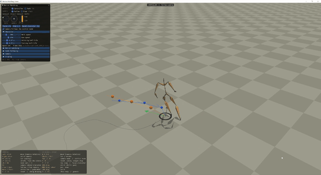 |
| The character follows a fixed square path. | The character is driven with a gamepad, and the path is edited in 3D with the mouse. |

▶ **Full video of the new version (1:57):** [download sample.mp4](image/sample.mp4?raw=true) (27 MB, 1920×1050, 60 fps)

| | Before | After |
|---|---|---|
| Driving the character | Follows a fixed path only. The gamepad only turned the camera. | A gamepad or the keyboard drives motion matching directly (walk, analog run, strafe), or the character follows a path. |
| Setting up the path | 4 waypoints, edited by typing coordinates into number fields. | Click, drag, insert and delete waypoints in 3D, with any number of points. There are also presets, undo/redo, snap to grid and save/load. |
| Camera | Orthographic view orbiting the world origin. | Third-person follow camera and a free camera, with a smooth switch between them. |
| Transitions | Direct cut (optional lerp). | Inertialization. |
| Getting it running | Needed a BVH file that isn't in the repo, plus LibTorch and a prebuilt GLFW. | Runs with the data in `data/`. Only the git submodules are needed. |

### Screenshots

| Controller mode (follow camera) | Path editor (free camera) |
|:---:|:---:|
| 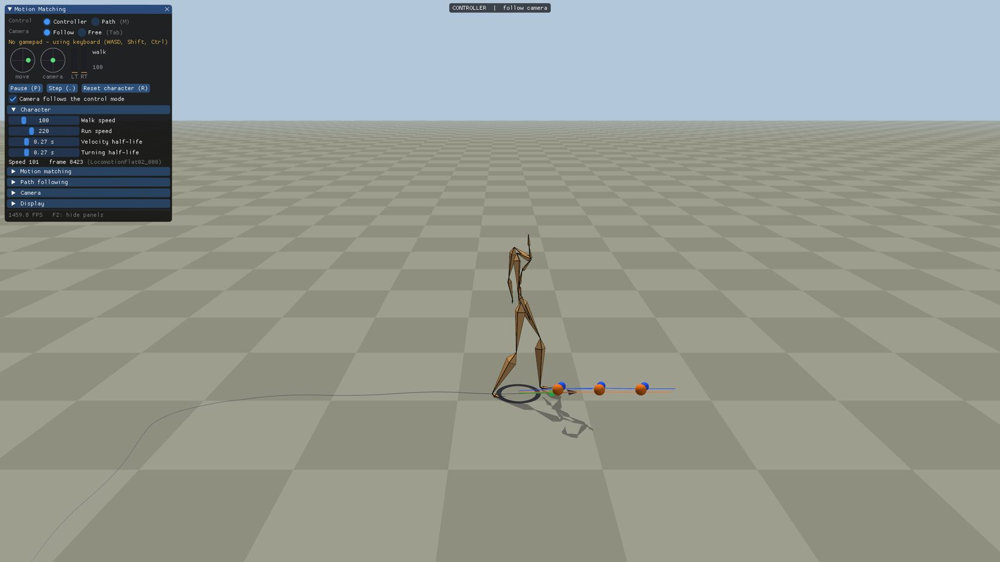 | 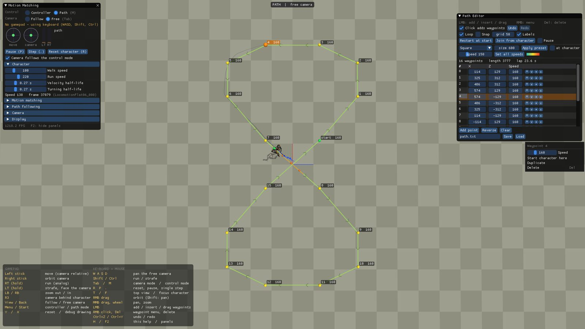 |

## New: Motions for Elderly Care and for Factories

There are two new sets of motion data. A **motion viewer** plays them with on-screen buttons, so no gamepad is needed.

- **Elderly and assisted walking.** These are motion captures of an actor performing an elderly gait, walking with a cane in either hand, and limping on either leg, plus an ordinary walk for reference. They come from the [100STYLE dataset](https://www.ianxmason.com/100style/) (CC BY 4.0). Motions like these can fill simulated care homes, hospitals and stations, for example to check accessibility or plan evacuations. They can also help train caregivers and show how a rehabilitation is going.
- **A robot arm that cleans and assembles.** A 6-axis arm on a workbench wipes a coffee spill off the table, stacks four parts on a fixture, and drives the screws of a housing lid. [tools/make_robot_clips.py](tools/make_robot_clips.py) generates these clips like a robot program, with joint moves, straight tool moves and inverse kinematics, so they are free to use (MIT).

| Elderly gait next to an ordinary walk (treadmill view) | Walking with a cane |
|:---:|:---:|
| 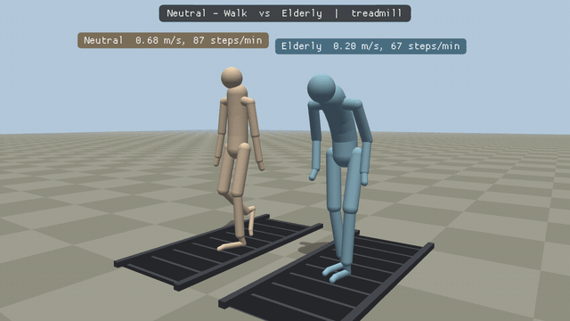 | 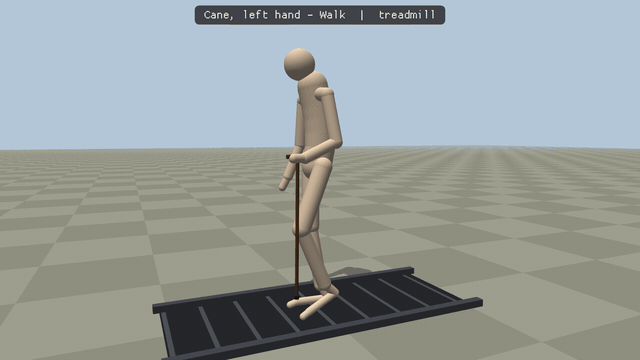 |
| The elderly walk is stooped, slow and short-stepped. The labels show the speed and cadence that the viewer measures in each clip. | The capture only has the hand, so the viewer adds the cane: it is planted on the floor and pivots while the hand moves over it. |

| Cleaning: wipe the table | Assembly: pick and place | Assembly: drive screws |
|:---:|:---:|:---:|
| 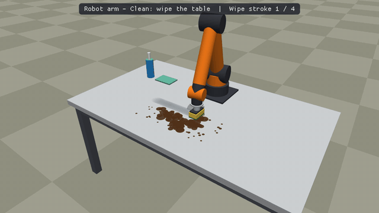 | 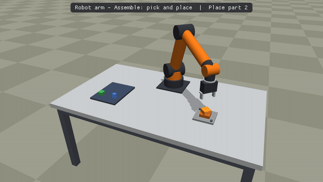 | 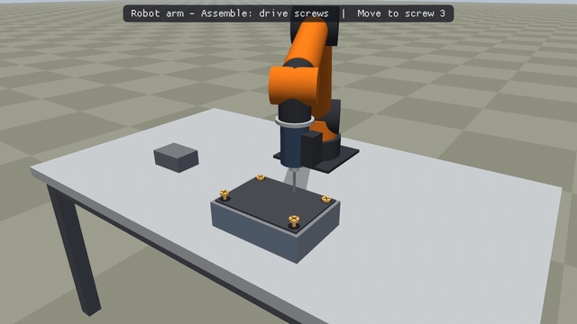 |
| Overlapping strokes with a sponge, then circles on a dried stain. The dirt fades where the sponge has passed. | Four parts move from a tray to a fixture. Two of them are turned 45° on the way. | Each screw turns and sinks into the lid while the screwdriver presses on it. |

### Motion Viewer

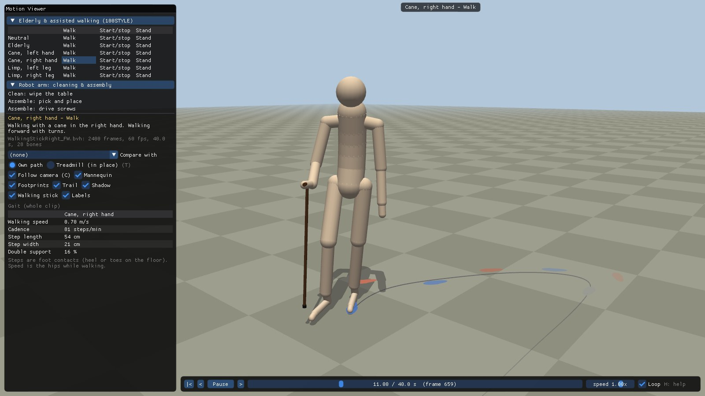

- Pick a clip with the buttons on the left. Each person has a walk, a clip of starting / stopping / turning, and a standing clip.
- The bar at the bottom plays, pauses, steps frame by frame, scrubs the timeline and changes the speed.
- **Compare with** shows a second clip next to the first. **Treadmill** makes both walk in place, so their postures line up.
- The viewer finds the foot contacts and measures the gait of each clip: walking speed, cadence, step length, step width, and double support (the share of walking time with both feet on the floor).
- Footprints, the path and the walking stick can be shown on the floor. The figure is drawn as a mannequin or as plain bones.
- For the robot, the program steps are listed and marked on the timeline. Click a step to jump to it.

The gait of the 40 s walking clips (`*_FW.bvh`), as measured by the viewer:

| Style | Walking speed | Cadence | Step length | Double support |
|---|---|---|---|---|
| Neutral | 0.68 m/s | 87 steps/min | 50 cm | 17 % |
| Elderly | 0.20 m/s | 67 steps/min | 16 cm | 48 % |
| Cane, left hand | 0.69 m/s | 81 steps/min | 51 cm | 16 % |
| Cane, right hand | 0.70 m/s | 81 steps/min | 54 cm | 16 % |
| Limp, left leg | 0.52 m/s | 91 steps/min | 36 cm | 22 % |
| Limp, right leg | 0.59 m/s | 102 steps/min | 36 cm | 13 % |

Walking speed and double support time are standard clinical gait measures. The elderly clip walks at under a third of the reference speed and has both feet on the floor for about half of the time.

| Elderly next to an ordinary walk | Limp next to an ordinary walk | Cane, with footprints (blue: left, red: right) |
|:---:|:---:|:---:|
| 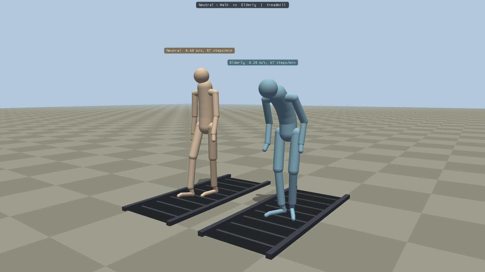 | 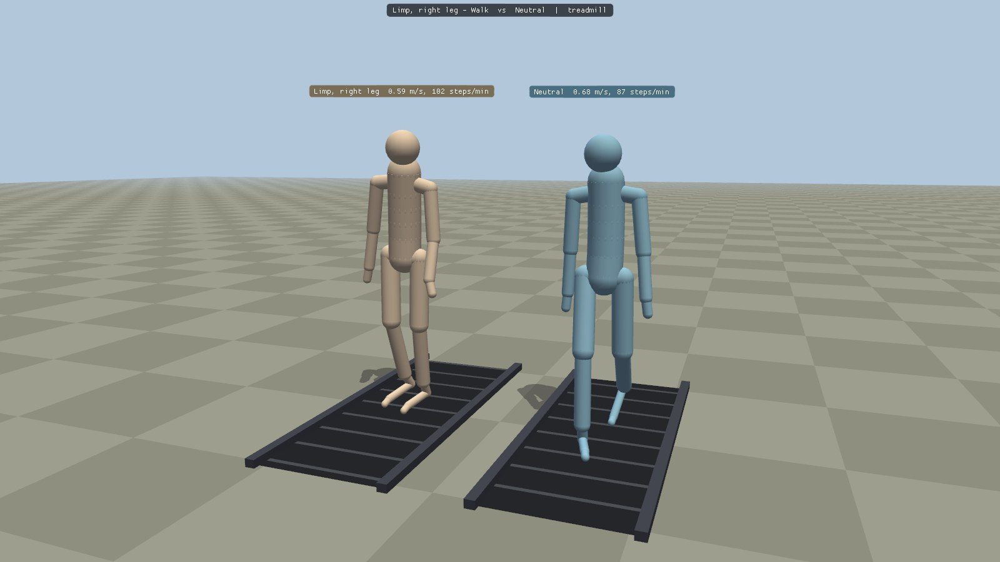 | 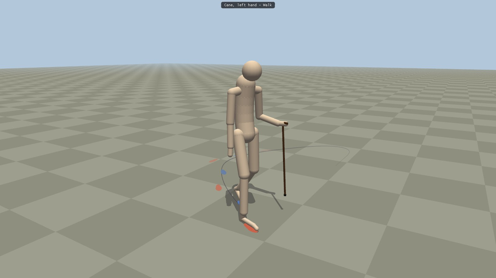 |

| Wipe the table | Pick and place | Drive screws |
|:---:|:---:|:---:|
| 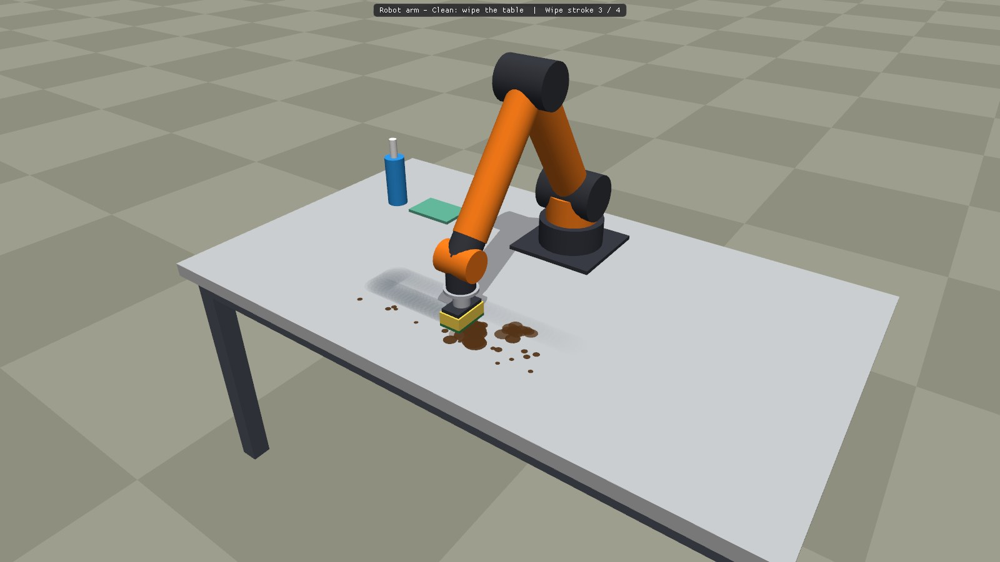 | 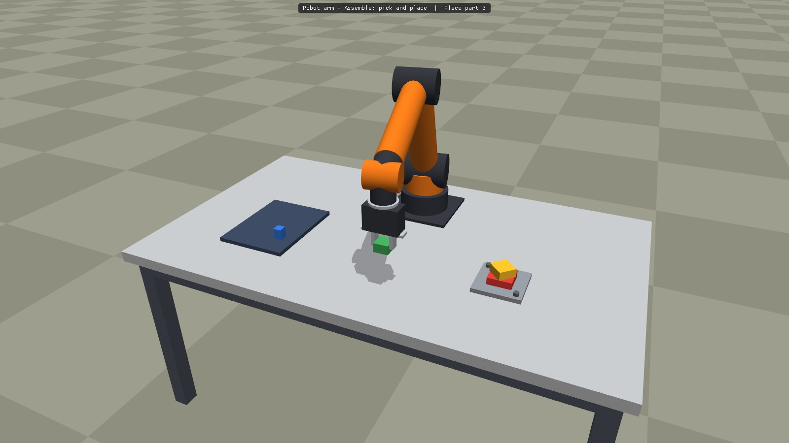 | 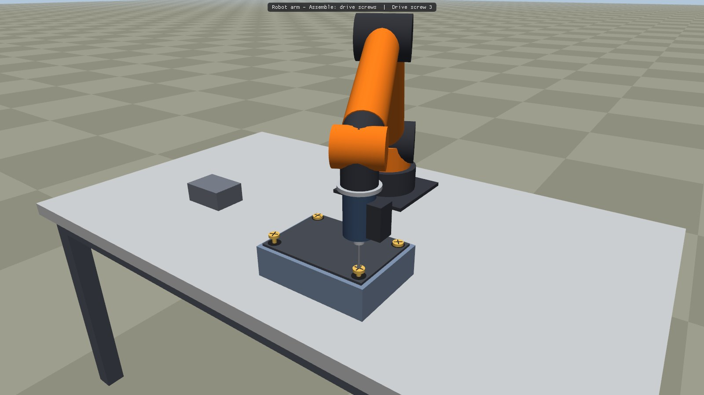 |

Run it with `Source/build/Release/Motion_viewer.exe` on Windows or `./build/Motion_viewer` on Linux (see [Build from Source](#build-from-source)).

| Input | Action |
|---|---|
| Buttons on the left | choose a clip, compare two clips, treadmill, display options |
| Space, Left / Right (Shift: 10 frames) | play / pause, step one frame |
| Home / End, Up / Down | first / last frame, faster / slower |
| T, C | treadmill on / off, follow camera on / off |
| Mouse drag, wheel, Shift + drag | orbit, zoom, pan |

Any other BVH file can be opened too: `Motion_viewer my_capture.bvh --scale 1.0`.
`Motion_viewer --capture [dir]` renders the screenshots and GIF frames of this README, and `python tools/make_readme_media.py <dir>` turns them into the files in `image/`.

## Features

- **Motion matching** on a 27-dimensional feature (future trajectory positions and facing at +20/+40/+60 frames, foot positions and velocities, hip velocity), brute-force search in ~1 ms over 75k frames.
- **Inertialization** for smooth transitions between clips (can be turned off to see the raw jumps).
- **Gamepad control**: any controller GLFW knows (Xbox, PlayStation, Switch Pro, most generic pads) drives a critically damped spring trajectory relative to the camera. Analog run on the right trigger, strafing on the left trigger. Hot-plugging is supported, and the keyboard works as a fallback.
- **Two cameras**:
  - *Follow*: a third-person camera that trails the character. Orbit it with the right stick or the right mouse button.
  - *Free*: a detached orbit camera for looking around and editing the path (orbit, pan on the ground, zoom, top view).
  Switching between them is a smooth move rather than a cut. By default the camera switches with the control mode, and you can switch it by hand at any time.
- **Interactive path editor**: click on the ground to add waypoints, click a segment to insert one, drag to move, right click for a menu. It also has undo/redo, snap to grid, presets (square, circle, figure eight, star, slalom, zigzag, random), per-segment speeds with color coding, a waypoint table, and save/load.
- Works with the bundled PFNN locomotion captures out of the box. It can also load the original `jl_motionMatching_hd.bvh` or any BVH files you pass on the command line.
- `--selftest`: replays scripted stick input and path edits, reports how well the character follows them, and saves screenshots.
- **Motion viewer** (`Motion_viewer`): plays the elderly / assisted walking and robot arm clips with buttons. It has side-by-side comparison, a treadmill view and gait measures.

## Controls

The same table is shown in the app (toggle it with **H**).

**Gamepad**

| Input | Action |
|---|---|
| Left stick | move (relative to the camera) |
| Right stick | orbit the camera |
| RT (hold) | run (analog: half pressed = jog) |
| LT (hold) | strafe: keep facing the camera direction |
| LB / RB | zoom out / in |
| R3 (click) | put the camera behind the character |
| View / Back | follow / free camera |
| Menu / Start | controller / path mode |
| Y | reset the character |
| X | toggle debug drawing |

**Keyboard and mouse**

| Input | Action |
|---|---|
| W A S D / arrows | move (in path mode with the free camera: pan the camera) |
| Shift / Ctrl (hold) | run / strafe |
| Tab | follow / free camera |
| M | controller / path mode |
| R, P, `.` | reset, pause, single step |
| T / F | top view / focus the free camera on the character |
| Right mouse drag | orbit (Shift + right drag: pan) |
| Middle mouse drag, wheel | pan, zoom |
| Left mouse drag | orbit (controller mode), Alt + left drag always orbits |
| G | toggle debug drawing |
| H / F2 | help / hide the panels |
| Esc | close menu, deselect, quit |

**Path editor (path mode)**

| Input | Action |
|---|---|
| Left click on the ground | add a waypoint after the selected one (or at the end) |
| Left click on a segment | insert a waypoint there |
| Left drag a waypoint | move it |
| Right click a waypoint | menu: speed, start the character here, duplicate, delete |
| Del / Backspace | delete the selected waypoint |
| Ctrl+Z / Ctrl+Y | undo / redo |

The *Path Editor* panel adds presets, snap to grid, loop on/off, "set all speeds", reverse, and the waypoint table with editable X / Z / speed. It can also save and load a path (`path.txt`, one `x z speed` per line).
A dashed preview shows where a click will add the next waypoint. Segments are colored from teal (slow) to red (fast). The green ball is the target that the character chases along the path. It waits for the character if the character falls too far behind.

## Build from Source

Only GLFW, delfem2 and ImGui are needed. ImGui is already in the repository and the other two are git submodules. LibTorch is **no longer required**.

```
git clone https://github.com/tomcatmew/simple_motion_matching.git
cd simple_motion_matching
git submodule update --init 3rd_party/delfem2 3rd_party/glfw
```

**Windows (Visual Studio 2019/2022)**

```
cd Source
cmake -S . -B build
cmake --build build --config Release
build\Release\Runtime_demo_mm.exe
```

You can also open `Source/build/Runtime_demo_mm.sln`, set the configuration to *Release*, and run. Debug builds work but are slow.
The same build also makes the motion viewer, `build\Release\Motion_viewer.exe`.

**Linux**

```
sudo apt install libx11-dev libxrandr-dev libxinerama-dev libxcursor-dev libxi-dev libgl1-mesa-dev
cd Source
cmake -S . -B build -DCMAKE_BUILD_TYPE=Release
cmake --build build -j
./build/Runtime_demo_mm
./build/Motion_viewer
```

GLFW is built from the `3rd_party/glfw` submodule. If you prefer a prebuilt GLFW as in the original setup, put it in `3rd_party/libglfw` (with `include/` and `lib-*` folders) and CMake will use it instead.
The old neural network experiments in `model.h` still need LibTorch. To enable them, configure with `-DMM_USE_TORCH=ON` and put LibTorch in `3rd_party/libtorch`.

## Motion Data

The demo looks for `data/` next to the source tree (or in the working directory) and picks the first of these that exists:

1. **BVH files given on the command line**, e.g. `Runtime_demo_mm my_capture.bvh other.bvh --scale 1.0`. All files must share one skeleton. `--scale` converts the file units to roughly centimeters.
2. **`data/jl_motionMatching_hd.bvh`**, the capture used by the original version of this demo. It is the sample data of [JLPM22/MotionMatching](https://github.com/JLPM22/MotionMatching) (MIT license), shipped there as `Samples/Animations/BVH/jl_motionMatching_hd.txt`. Rename it to `.bvh` and copy it into `data/` to use it.
3. **The PFNN locomotion captures already in `data/`** (`LocomotionFlat*.bvh` and their mirrors, from [Holden et al.](http://theorangeduck.com/page/phase-functioned-neural-networks-character-control)). They are resampled from 120 to 60 fps and scaled to centimeters. This is the default, so the demo runs right after cloning.

Bones are found by name (`LeftArm`/`LeftShoulder`, `LeftUpLeg`/`LeftHip`, `LeftFoot`/`LeftAnkle`, ...), so other common skeletons work too.
The walk and run speeds are read from the data at startup. The database takes about 3 s to build.

The motion viewer plays two more folders:

- **`data/100style/`**: 18 clips of 6 styles from [100STYLE](https://www.ianxmason.com/100style/): `Neutral`, `Old`, `WalkingStickLeft`, `WalkingStickRight`, `LimpLeft` and `LimpRight`, each as `FW` (walk), `TR1` (start / stop / turn) and `ID` (stand). They are 60 fps, in centimeters, trimmed and rounded to 13 MB. [data/100style/README.md](data/100style/README.md) has the license and the list of changes. `python tools/fetch_100style.py` downloads the originals again and rebuilds the folder.
- **`data/robot/`**: the robot arm clips (BVH, centimeters, 60 fps) and a `.scene` file for each: the workcell, the props, the dirt and the program steps. The props are extra joints of the BVH, so the clips also open in other BVH tools. `python tools/make_robot_clips.py` generates them again.

## Self Test

```
Runtime_demo_mm --selftest [output_dir]
```

The self test plays a scripted sequence: idle, walk, turn, run, run while orbiting the camera, stop, strafe, walk back, half stick, then the square path, path edits, and a figure-eight preset in top view. It prints, for each phase, the reached speed and the facing / moving direction error, plus the distance to the path. It also checks undo/redo, save/load and mouse picking. Screenshots go to `output_dir` (default `selftest/`). The exit code is non-zero if a hard check fails.

## How It Works

- `Source/motion_matching.h`: database construction, feature normalization, search, and playback.
  - Database construction: each clip is resampled to 60 fps. A *simulation root* is created on the ground: the smoothed hip position, facing the smoothed body forward direction computed from the shoulders and hips. Poses are stored relative to it.
  - Feature normalization: each group of features shares one deviation and has an adjustable weight in the UI.
  - Search: brute-force nearest neighbor with early-out, run every N frames and immediately when the stick changes a lot.
  - Playback: integrates the root motion of the database, so the character can go anywhere. Transitions are blended with inertialization (offsets decayed by a critically damped spring).
- `Source/main.cpp`: the application. It owns the 60 Hz simulation (gamepad → spring trajectory, or path follower → trajectory), building the query, rendering, and the UI.
- `Source/gamepad.h`: GLFW gamepad wrapper (deadzones, triggers, button edges).
- `Source/camera.h`: follow and free orbit cameras, picking rays, projection.
- `Source/path_editor.h`: path model (open/looped paths, closest point, presets, IO) and the mouse editor.
- `traj.h`: spring-damper helpers (from Daniel Holden's articles).

The motion viewer:

- `Source/viewer.cpp`: the viewer application: clip library, playback, comparison, UI, and the `--capture` script.
- `Source/motion_clip.h`: a BVH clip that can be posed at any time (frames are interpolated with slerp). For people, it also extracts a root on the floor (for the treadmill view), the foot contacts and gait measures, and the tip of a walking stick, which stays planted on the floor until the hand lifts it.
- `Source/mannequin.h`: the capsule mannequin (radii found from the bone names), the cane, footprints and the treadmill.
- `Source/robot_cell.h`: reads a `.scene` file and draws the workcell, the arm, its tools (gripper, sponge, screwdriver), the props, and the dirt that the sponge wipes away.
- `tools/make_robot_clips.py`: plans the robot programs (MoveJ / MoveL with minimum jerk timing), solves them with analytic inverse kinematics (spherical wrist, elbow up), and writes the BVH and `.scene` files.
- `tools/fetch_100style.py`, `tools/make_readme_media.py`: data download, and README images.

## Credits

- Daniel Holden, *[Learned Motion Matching](https://theorangeduck.com/page/learned-motion-matching)*, *[Spring-It-On](https://theorangeduck.com/page/spring-roll-call)* and *[Phase-Functioned Neural Networks](http://theorangeduck.com/page/phase-functioned-neural-networks-character-control)* (mocap data).
- Jose Luis Ponton, [MotionMatching](https://github.com/JLPM22/MotionMatching) for Unity (optional `jl_motionMatching_hd` capture).
- [delfem2](https://github.com/nobuyuki83/delfem2) by Nobuyuki Umetani.
- *The 100STYLE Dataset - Ian Mason*: Ian Mason, Sebastian Starke and Taku Komura, [Real-Time Style Modelling of Human Locomotion via Feature-Wise Transformations and Local Motion Phases](https://arxiv.org/abs/2201.04439), 2022. The elderly and assisted walking clips, [CC BY 4.0](https://creativecommons.org/licenses/by/4.0/).

## Star History

<a href="https://www.star-history.com/#tomcatmew/simple_motion_matching&Date">
 <picture>
   <source media="(prefers-color-scheme: dark)" srcset="https://api.star-history.com/svg?repos=tomcatmew/simple_motion_matching&type=Date&theme=dark" />
   <source media="(prefers-color-scheme: light)" srcset="https://api.star-history.com/svg?repos=tomcatmew/simple_motion_matching&type=Date" />
   
 </picture>
</a>
